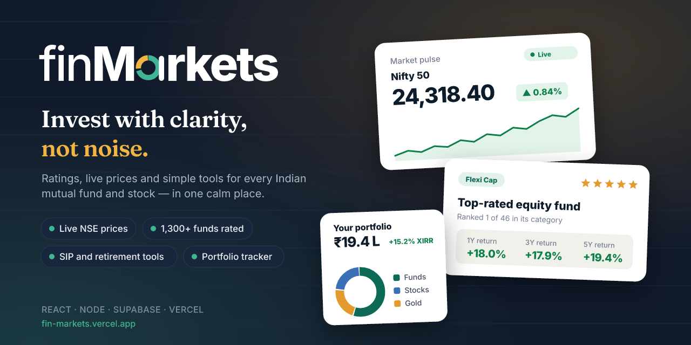

# finMarkets



**Live:** https://fin-markets.vercel.app

Research, ratings and tools for Indian mutual funds and stocks: a React (Vite) frontend plus a small Node/Express API that pulls live market data, caches it and computes ratings.

## Run

```bash
npm install
cp .env.example .env.local   # then fill in the Supabase keys (see below)
npm run dev                  # API on :8787 + web on :5173 (proxied /api)
```

Production: `npm run build && npm start`. One Node process serves the API and the built site on `PORT` (default 8787).

## Where the data comes from

| Data | Source | Freshness | Code |
| --- | --- | --- | --- |
| Mutual fund NAVs (all ~1,300 direct-growth schemes) | AMFI official NAV files | Daily, after ~9–11 PM IST; cached 1 h | `server/providers/amfi.js` |
| 1M–10Y fund returns, category averages, star ratings | Computed from AMFI NAVs on past dates | Recomputed with each NAV update | `amfi.universe()` |
| Fund NAV history, SIP XIRR, volatility, Sharpe, drawdown | mfapi.in (mirror of AMFI) | Cached 6 h | `amfi.history()`, `services.historyStats()` |
| Stock and index prices, 52W range, P/E, P/B | Yahoo Finance (unofficial) | ~15 min delayed; cached 60 s; browser polls every 60 s | `server/providers/yahoo.js` |
| ROE, margins, growth, shareholding, profile | Yahoo Finance | Cached 12 h | `yahoo.summary()` |
| Annual revenue / profit / EPS | Yahoo Finance | Cached 24 h | `yahoo.financials()` |
| Stock scores (Q/G/V/M) and stock ratings | Computed vs. ~100 tracked NSE stocks | With every price refresh | `services.scoreAll()` |
| Stories, learning content, IPO and NFO calendars, plans | Editorial, in `src/data/` | Manual | — |

**Before public launch:** NSE/BSE require a licence to redistribute prices. Replace `server/providers/yahoo.js` with a licensed vendor (TrueData, Global Datafeeds, a broker API, etc.) that implements the same exported functions (`quotes`, `chart`, `summary`, `financials`, `search`). Nothing else needs to change.

Not yet sourced: fund expense ratio, AUM and portfolio holdings (published monthly by AMCs), and IPO/NFO calendars.

## Login and per-user data (Supabase)

1. Create a project at supabase.com. Copy **Project URL** and **anon public key** into `.env.local`.
2. In the SQL editor, run `supabase/schema.sql` (creates the `holdings` and `watchlist` tables with row-level security).
3. Under Authentication → URL Configuration, set **Site URL** to your site and add `http://localhost:5173/**` to the redirect URLs.
4. Optional, for Google sign-in: Authentication → Providers → Google, then paste your Google OAuth client ID and secret.

Pages: `/signup`, `/login`, `/forgot-password`, `/reset-password`, `/account` (profile, password, watchlist). `/portfolio` shows a live-valued sample when signed out and your saved holdings when signed in.

## API

```
GET /api/market/overview            indices, sectors, global, commodities, breadth
GET /api/market/chart/:symbol?range=1D|1M|6M|1Y|3Y|5Y|MAX
GET /api/stocks                     tracked universe with live quotes + scores
GET /api/stocks/:ticker             any NSE stock: quote, profile, financials, scores, peers
GET /api/stocks/:ticker/chart?range=
GET /api/funds?q&type&category&minRating&list&sort&dir&limit&offset
GET /api/funds/meta                 categories, curated-list counts, NAV date
GET /api/funds/:code                fund + history stats + category peers
GET /api/funds/:code/chart?range=
GET /api/prices?stocks=TCS,INFY&funds=122639     batched live prices
GET /api/search?q=
```

## Structure

```
server/
  providers/   amfi.js, yahoo.js: the only files that talk to outside sources
  universe/    tracked stocks and index symbols
  services.js  ratings, scores, stats, search
  lib/cache.js TTL cache: in-flight de-duplication, serves stale data on upstream failure, optional disk cache
src/
  api/         useApi hook (polling), Supabase user data hooks
  auth/        AuthContext (Supabase)
  pages/       one file per route
  components/  layout, charts, gauges, status states
  data/        editorial content only
supabase/schema.sql
```

## SEO

- Page titles/descriptions/structured data live in `src/seo/meta.js` (shared by browser and server).
- `server/seo.js` puts the right `<head>` tags into the HTML for every URL (crawlers and link previews
  don't run JavaScript), and serves `/robots.txt` and `/sitemap.xml` (all funds, stocks and stories).
- Moving to a custom domain: change `SITE_URL` in `src/seo/meta.js` and the URLs in `index.html`.
- Search engine verification: set `GOOGLE_SITE_VERIFICATION` and/or `BING_SITE_VERIFICATION`
  (the `content` value of their meta tag) as Vercel environment variables and redeploy.
- Share image and icons (`public/og-image.png`, `icon-*.png`, `apple-touch-icon.png`) are rendered from SVG
  with the brand fonts; regenerate them if the logo changes.
